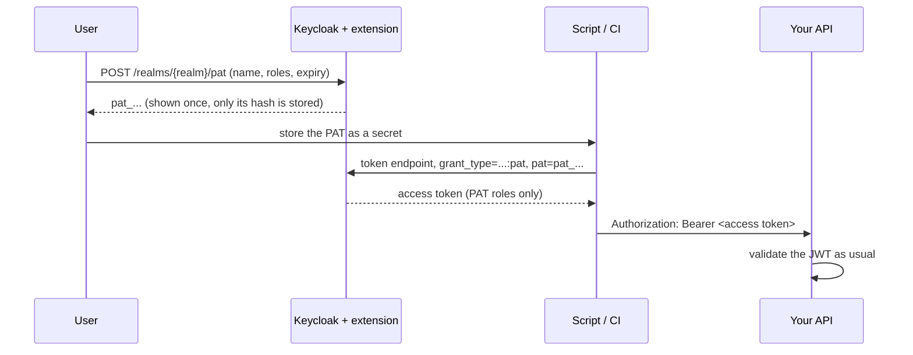

# Keycloak Personal Access Token

[](https://github.com/cloud-iam/Keycloak-Personal-Access-Token/actions/workflows/build.yml)
[](LICENSE)
[](https://www.keycloak.org)

**GitHub-style Personal Access Tokens for Keycloak.** Users create long-lived, revocable tokens limited to a subset
of their roles, for their scripts, CI/CD pipelines and CLIs. A PAT is exchanged for a **standard Keycloak access
token**.

```bash
curl -s https://keycloak.example.com/realms/acme/protocol/openid-connect/token \
  -d grant_type=urn:cloudiam:params:oauth:grant-type:pat \
  -d client_id=my-cli \
  -d pat=pat_ZTFhZjZl...
```

> [!TIP]
> Don't want to run Keycloak yourself? This extension is available on [Cloud-IAM](https://www.cloud-iam.com)'s
> managed Keycloak.

## Contents

- [Why](#why)
- [Features](#features)
- [How it works](#how-it-works)
- [Getting started](#getting-started)
  - [Installation](#installation)
  - [Setup](#setup)
  - [Quickstart](#quickstart)
- [Reference](#reference)
  - [REST API](#rest-api)
  - [Token exchange](#token-exchange)
  - [Validating tokens in your API](#validating-tokens-in-your-api)
- [Security model](#security-model)
  - [Known limits](#known-limits)
- [Troubleshooting](#troubleshooting)
- [FAQ](#faq)
- [Build from source](#build-from-source)
- [Issues and contributions](#issues-and-contributions)
- [License](#license)

## Why

Scripts and pipelines need to call your APIs as a user. The usual options all hurt:

| Option | Problem |
|---|---|
| The user's password | Shared everywhere, breaks MFA, carries all of the user's rights |
| A service account (client credentials) | Not the user: audit logs and per-user permissions are lost, and it is one more client to manage |
| An offline token | Hard to see, list and revoke; carries all of the user's roles |

A Personal Access Token is the user's own credential: **named, limited to the roles they choose, with an expiry**,
listed and revocable at any time, and shown only once.

## Features

- **Self-service**: users create, list, rotate and delete their own PATs through a REST API
- **Scoped**: a PAT carries only the realm and client roles chosen at creation (composites included), never more
  than its owner holds
- **Standard tokens**: the exchange returns a regular, signed Keycloak access token built from the requesting
  client's scopes and mappers; validate it locally or through introspection like any other token
- **Expiry**: 1 to 365 days, 90 by default, or never
- **Safe storage**: only a SHA-256 hash is stored; the token is shown once
- **Opt-in**: admins choose which clients accept PATs and which may manage them
- **Audited**: every exchange is a Keycloak login event (`pat_id`, `pat_name`), every change an admin event
- **Hardened**: tokens obtained with a PAT cannot reach the Admin API, manage PATs, or be turned into broader tokens
  (see the [security model](#security-model))

## How it works



No refresh token is issued: the script exchanges the PAT again when the access token expires.

## Getting started

### Installation

You need:

- **Keycloak 26.8.2 or later**, with the Admin API audience check left on (the default). Keycloak's Admin API
  authorizes with the user's stored roles rather than the token's; 26.8.2 is the first version that keeps tokens
  obtained with a PAT away from it.
- The **`token-exchange` (V1) preview feature off** (the default). Standard token exchange (V2) is fine.

> [!CAUTION]
> On a Keycloak that doesn't meet these, a PAT could carry all of its owner's rights, admin rights included. The
> extension checks both at startup: if either fails, it refuses every PAT exchange and logs why.

| Extension | Keycloak | Status |
|---|---|---|
| 1.x | 26.8.2 | Tested in CI on every build |
| 1.x | later 26.x | Expected to work; the startup checks protect you if Keycloak changes what the extension relies on |
| 1.x | before 26.8.2 | Not supported: PAT exchange stays disabled |

Then:

1. Download `keycloak-personal-access-token-<version>.jar` from the
   [latest release](https://github.com/cloud-iam/Keycloak-Personal-Access-Token/releases).
2. Copy it into `$KEYCLOAK_HOME/providers/` (`/opt/keycloak/providers/` in the container image).
3. Run `kc.sh build` if you use optimized startup, then restart Keycloak.

With Docker:

```dockerfile
FROM quay.io/keycloak/keycloak:26.8.2
COPY keycloak-personal-access-token-*.jar /opt/keycloak/providers/
RUN /opt/keycloak/bin/kc.sh build
```

### Setup

The extension creates two client scopes in every realm, existing and new:

| Client scope | Assign it to | Effect |
|---|---|---|
| `pat-exchange` | the clients that **accept PATs** (your CLI, your CI client...) | the client may exchange PATs for tokens |
| `pat-management` | the clients that **manage PATs** (your developer portal...) | tokens carrying this scope may call the PAT API |

`pat-exchange` is assigned to no client; `pat-management` is an optional scope of `admin-cli`. In the admin console:
*Clients* > your client > *Client scopes* > *Add client scope*, as **default** or **optional**. A client requests an
optional scope with `scope=pat-management`.

> [!IMPORTANT]
> Only role claims are narrowed to the PAT. Keep group, user attribute and hardcoded-role mappers off the clients that
> accept PATs, unless the data they add is fine for any of the user's PATs (see [known limits](#known-limits)).

### Quickstart

With a realm `acme`, a user `alice`, a client `dev-portal` with the `pat-management` scope and a client `my-cli` with
the `pat-exchange` scope:

```bash
KC=https://keycloak.example.com/realms/acme

# 1. Alice logs in to the developer portal, asking for the pat-management scope
#    (password grant to keep the example short; your portal would use its normal login)
USER_TOKEN=$(curl -s $KC/protocol/openid-connect/token \
  -d grant_type=password -d client_id=dev-portal -d scope=pat-management \
  -d username=alice -d password=... | jq -r .access_token)

# 2. She creates a PAT limited to one of her roles, valid 30 days
PAT=$(curl -s $KC/pat -H "Authorization: Bearer $USER_TOKEN" -H 'Content-Type: application/json' \
  -d '{"name": "ci-deploy", "roles": ["api-read"], "expirationDays": 30}' | jq -r .token)

# 3. Her CI job exchanges the PAT for an access token
ACCESS_TOKEN=$(curl -s $KC/protocol/openid-connect/token \
  -d grant_type=urn:cloudiam:params:oauth:grant-type:pat -d client_id=my-cli \
  -d pat=$PAT | jq -r .access_token)

# 4. ...and calls your API as alice, with api-read only
curl -H "Authorization: Bearer $ACCESS_TOKEN" https://api.example.com/things
```

## Reference

### REST API

`/realms/{realm}/pat`, with a bearer token carrying the `pat-management` scope. Users only ever see and manage
**their own** PATs. Admins revoke any user's PAT as a credential: *Users* > the user > *Credentials*, or
`DELETE /admin/realms/{realm}/users/{userId}/credentials/{patId}`.

| Method | Path | Body | Result |
|---|---|---|---|
| `POST` | `/` | `{"name", "roles"?, "expirationDays"?}` | `201`, the PAT with its `token`, shown once |
| `GET` | `/` | | `200`, the caller's PATs, without token values |
| `GET` | `/{id}` | | `200`, one PAT |
| `POST` | `/{id}/rotate` | `{"expirationDays"?}` (optional) | `200`, a new `token`; the old value stops working at once |
| `DELETE` | `/{id}` | | `204` |

| Create field | Default | Rules |
|---|---|---|
| `name` | required | unique per user, up to 255 characters, no control characters |
| `roles` | `[]` | up to 50; `"role"` for a realm role, `"clientId:role"` for a client role; you must hold each one |
| `expirationDays` | `90` | 1 to 365, or `null` for a PAT that never expires |

A user holds at most 25 PATs. Rotation keeps the expiry unless `expirationDays` is given. Unknown fields, such as
`userId`, are refused. Errors come back as `{"error": "<message>"}`.

```json
{
  "id": "851eb5f3-eec9-4b5d-b97a-52a18ba2f427",
  "name": "ci-deploy",
  "token": "pat_NWYxYjk3ZGEt....x-UYy4uwe7eYKKGkLtRDQU3e0n_e0cSlfW-ZYgi7sFE",
  "roles": ["api-read"],
  "createdAt": 1795530555.368,
  "expiresAt": 1798122555.367
}
```

Listed PATs also carry `lastUsedAt` and `active` (not expired). Timestamps are epoch seconds.

Role names may contain `:` (`"app:read"`, `"urn:example:app:viewer"`): every reading is tried, and a name matching
several roles is refused. Roles are resolved by name at each exchange, as your APIs read them: a role deleted and
recreated with the same name applies to existing PATs, and a role the user lost, or that became ambiguous, is
dropped from the token.

### Token exchange

```http
POST /realms/{realm}/protocol/openid-connect/token
Content-Type: application/x-www-form-urlencoded

grant_type=urn:cloudiam:params:oauth:grant-type:pat&pat=<PAT>&client_id=<client>[&client_secret=<secret>][&scope=<scopes>]
```

The access token is built by Keycloak for the requesting client (its scopes, mappers and audience), with the roles
narrowed to the PAT's. It adds:

| Claim | Value |
|---|---|
| `grant_type` | `urn:cloudiam:params:oauth:grant-type:pat` |
| `pat_id`, `pat_name` | the PAT used |
| `pat_roles` | the PAT's roles this token carries |

```json
{
  "preferred_username": "alice",
  "azp": "my-cli",
  "realm_access": { "roles": ["api-read"] },
  "scope": "email profile",
  "grant_type": "urn:cloudiam:params:oauth:grant-type:pat",
  "pat_id": "851eb5f3-eec9-4b5d-b97a-52a18ba2f427",
  "pat_name": "ci-deploy",
  "pat_roles": ["api-read"]
}
```

There is no refresh token and no ID token: the `openid` scope is dropped, and Keycloak's userinfo endpoint refuses
these tokens.

### Validating tokens in your API

Nothing specific: validate the access token as you validate any Keycloak token.

- **Locally** (JWKS): check the signature against the realm keys, `exp`, `iss`, and `aud` if your API requires its
  own audience. Most frameworks do this out of the box.
- **Through introspection**: as for any Keycloak token, the introspecting client must be in the token's audience
  (add an *Audience* mapper for your API to the client that exchanges PATs), otherwise Keycloak answers
  `active: false`. Introspection returns the token's own claims, with the PAT's roles only.

Authorize from the token's role claims (`realm_access`, `resource_access`), never by looking the user up again: see
[known limits](#known-limits).

## Security model

- **Roles narrowed**: every role claim (`realm_access`, `resource_access`, microprofile-jwt `groups`, role mappers)
  is limited to the PAT's roles and their composites, and to roles the user still holds
- **Never the Admin API**: exchanges that would produce an Admin API token, such as through `admin-cli`, are refused,
  and Keycloak 26.8.2+ refuses other realm tokens on its Admin API
- **No escalation through Keycloak**: tokens obtained with a PAT are refused by token exchange, UMA, the JWT
  authorization grant, userinfo and the Account API, and keep their own claims on introspection; clients issuing
  lightweight access tokens cannot exchange PATs. To do this, the extension replaces Keycloak's token exchange, UMA
  and jwt-bearer grants and its access token introspection with Keycloak's own implementation plus a check. If
  another extension replaces one of them, PAT exchange is disabled and an error is logged at startup
- **PATs can't make PATs**: tokens obtained with a PAT cannot call the PAT API, so a leaked PAT cannot mint more PATs
  or outlive its revocation
- **Account state**: disabled users, service accounts and users with pending required actions (such as an
  admin-forced password update) cannot exchange PATs; service accounts and impersonated sessions cannot manage them
- **Storage**: a PAT is `pat_<base64url(user id)>.<base64url(32 random bytes)>`; only its SHA-256 hash is stored,
  compared in constant time. With 256 random bits, failed attempts are not counted toward Keycloak's brute force
  lockout: counting would let anyone who knows a user id lock that user out
- **Opt-in clients**: only clients with `pat-exchange` accept PATs, and only tokens with `pat-management` manage them

### Known limits

> [!WARNING]
> **A PAT narrows the token Keycloak issues, nothing else.** Anything that takes that token only as proof of who the
> user is, then reads the user's roles again, gets **all of the user's roles**, not the PAT's. The extension closes
> every such path it knows inside Keycloak; the ones below are yours to handle:
>
> - **Your services**: authorize from the token's claims (`realm_access`, `resource_access`). Looking the user up
>   again, for example through the Admin API with a service account, gives a PAT its owner's full rights.
> - **Mappers**: group, user attribute and hardcoded mappers are not narrowed. On a client that accepts PATs, they
>   expose their data to every PAT of the user: keep them off those clients.
> - **Role-restricted client scopes** are applied according to all of the user's roles. The role claims they add are
>   still narrowed, but other mappers in them run for every PAT.
> - **Authorization Services**: the protection API checks `uma_protection` against the user's stored roles. Don't give
>   that role to users who create PATs.
> - **Admins**: an admin with `manage-users` can add a PAT credential to a user, as they could set the user's
>   password. Treat `manage-users` as full access to the realm's users.

## Troubleshooting

| Error | Cause and fix |
|---|---|
| `unauthorized_client`: Client … does not accept Personal Access Tokens | Assign the `pat-exchange` scope to the client |
| `unauthorized_client`: … cannot be exchanged for Admin API tokens | The client issues Admin API tokens (such as `admin-cli`): use another client |
| `unauthorized_client`: … lightweight access tokens | The client, or a client policy, issues lightweight tokens: use another client |
| `unsupported_grant_type` | Keycloak older than 26.8.2, admin audience check off, `token-exchange` V1 on, or another extension replacing a grant the extension guards: see the startup log |
| `invalid_grant`: Invalid or expired Personal Access Token | Wrong, rotated, revoked or expired PAT |
| `invalid_grant`: Account disabled / Account is not fully set up / Service accounts cannot use… | The owner is disabled, has pending required actions, or is a service account |
| `403`: … requires a token with the pat-management scope | Request `scope=pat-management` from a client that has the scope |
| `403` on the PAT API, other messages | The token was obtained with a PAT, or belongs to a service account or an impersonated session |
| `400`: Role not found / Ambiguous role / User does not have role | Check the role name, the `clientId:role` format, and that the user holds the role |
| `400`: Maximum number of PATs reached (25) | Delete unused PATs |
| Introspection answers `active: false` | Add the introspecting client to the token's audience (see [validating tokens](#validating-tokens-in-your-api)) |

## FAQ

**Can an admin create a PAT for a user?** No, PATs are self-service only. Admins can list and revoke them.

**Where are PATs stored?** As Keycloak user credentials (type `pat`) in Keycloak's database. Realm exports include
them (hash and metadata only), and they keep working after a re-import.

**Can my company use it?** Yes, including in production and in commercial products. What the licence forbids is
offering the extension to others as a hosted or managed service.

**Does it work with my API framework?** Yes: the exchanged token is a standard Keycloak access token.

**Can I see when a PAT was last used?** Yes: `lastUsedAt` in the API, and every exchange is a login event.

## Build from source

Requires Java 21 and Docker: the integration tests run a real Keycloak with Testcontainers.

```bash
mvn verify                          # build and run the tests
mvn package -DskipTests             # jar only: target/keycloak-personal-access-token-*.jar
KEYCLOAK_VERSION=26.8.2 mvn verify  # test against a given Keycloak version
```

## Issues and contributions

Bug reports and feature requests are welcome as [issues](https://github.com/cloud-iam/Keycloak-Personal-Access-Token/issues).
We don't accept pull requests for now.

Found a vulnerability? Please don't open an issue: see [SECURITY.md](SECURITY.md).

## License

Source-available under the [Elastic License 2.0](LICENSE) (ELv2). In short, you may use, modify and redistribute
the extension, at work and in commercial products, as long as you:

- don't offer it to third parties as a hosted or managed service (for example a managed Keycloak offering with this
  extension as one of its features)
- keep the licence, copyright and other notices

See [LICENSE](LICENSE) for the exact terms. For other uses, [contact Cloud-IAM](https://www.cloud-iam.com).

---

Built and maintained by [Cloud-IAM](https://www.cloud-iam.com), managed Keycloak hosting. Need Keycloak in production
without the operations work? [Talk to us](https://www.cloud-iam.com).
